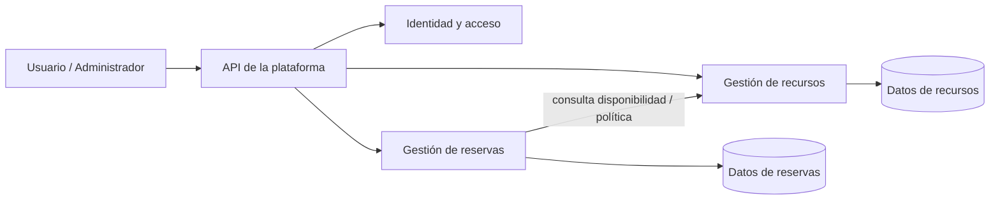

# Arquitectura propuesta

**Estado:** boceto sujeto a validación del segmento y reglas. El diagrama evita fijar infraestructura innecesaria antes del MVP.

## Contexto

Los usuarios de una organización consultan disponibilidad y reservan recursos. Los administradores mantienen recursos y políticas. El sistema registra reservas, protege los datos por organización y evita conflictos de horario.

## Componentes candidatos

Los componentes son responsabilidades candidatas, no una decisión irrevocable de desplegar tres microservicios. Para el primer incremento se puede iniciar con pocos servicios, siempre que la separación de datos y contratos quede clara y el costo operativo sea manejable.

## Límites candidatos

- **Identity:** usuarios, roles y autenticación; podría delegarse en un proveedor si el piloto lo requiere.
- **Resource:** catálogo, configuración y disponibilidad base de recursos.
- **Booking:** solicitudes, estados, cancelaciones y prevención de conflictos.
- **API de entrada:** puerta común si el escenario y el aprendizaje justifican Gateway.

## Reglas de datos y comunicación

- El servicio de reservas es autoridad para crear/cancelar reservas.
- El servicio de recursos es autoridad para atributos y disponibilidad planificada del recurso.
- No compartir tablas entre servicios.
- Mantener el flujo de reserva síncrono para confirmar disponibilidad de inmediato.
- Resolver solapamiento de forma atómica en persistencia; definir implementación después de elegir modelo de datos y motor.

## Seguridad y operación

- Autenticación centralizada y autorización en cada servicio.
- Validar pertenencia a organización y propiedad de la reserva en operaciones de lectura/escritura.
- Despliegue local primero con PostgreSQL y Docker Compose.
- Añadir health checks, logs y métricas mínimas antes de un piloto compartido.

## Decisiones abiertas

1. Uno, dos o tres servicios desplegables para el MVP.
2. Identidad propia vs proveedor externo.
3. Gateway y Service Discovery para piloto vs entorno didáctico local.
4. Control de concurrencia y definición de disponibilidad/buffers.
5. Hosting, backups, retención y monitoreo requeridos por el primer usuario.
